# ฝึกใช้ GitHub Projects แทน Jira

คู่มือแบบภาพ 18 ขั้น ภาพถ่ายจากหน้าจอ GitHub จริงของ Project [เงินไปไหน – Dev](https://github.com/users/pthanathon/projects/22) เมื่อ 28 ต.ค. 2569 เลขในวงกลมแดงในภาพตรงกับเลขในคำอธิบายใต้ภาพ

> ฉบับ HTML อ่านง่ายกว่า: เปิด `docs/github-projects-practice.html` ในเบราว์เซอร์

## เทียบคำศัพท์ Jira → GitHub

| Jira | GitHub | หมายเหตุ |
|---|---|---|
| Project / Board | **Project** | Project เดียวดึง issue จากหลาย repo ได้ |
| Epic | **Parent issue + sub-issues** | issue แม่แสดงความคืบหน้าของ sub-issue ให้เอง |
| Story / Task / Bug | **Issue** + **label** + template | Issue types ของจริงมีเฉพาะ repo ใน organization |
| Story points | ฟิลด์ **Estimate** (Number) | template Team planning มีให้แล้ว |
| Sprint | ฟิลด์ **Iteration** | template ตั้งไว้ sprint ละ 2 สัปดาห์ |
| Backlog | view ตารางที่กรอง `no:iteration` |  |
| Sprint board | view **Board** กรอง `iteration:@current` |  |
| Fix version | **Milestone** |  |
| Component | **Label** |  |
| Burndown | Insights → **Burn up** | ไม่มี burndown ในตัว ใช้ burn up แทน (ขั้นที่ 17–18) |

## 1. เตรียม repo

ทำครั้งเดียว ก่อนเริ่มสร้าง issue

### ขั้นที่ 1: เปิดหน้า Labels ของ repo

[เปิดหน้านี้](https://github.com/pthanathon/NgenPaiNai/labels)

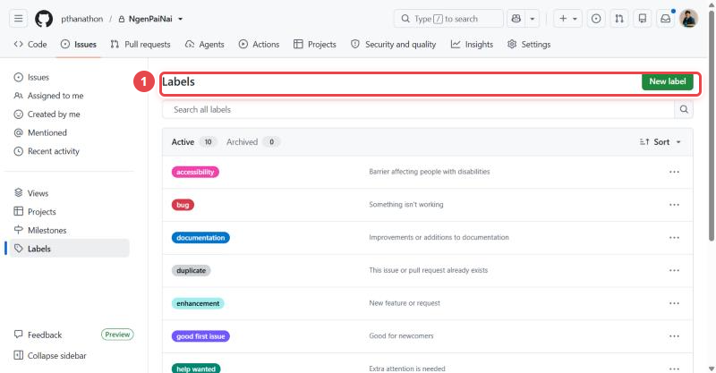

1. กด **New label** เพื่อสร้าง label ใหม่ ตอนนี้ยังไม่มี `story`, `task` และ `epic` (มีแค่ `bug`)

### ขั้นที่ 2: สร้าง label story, task และ epic

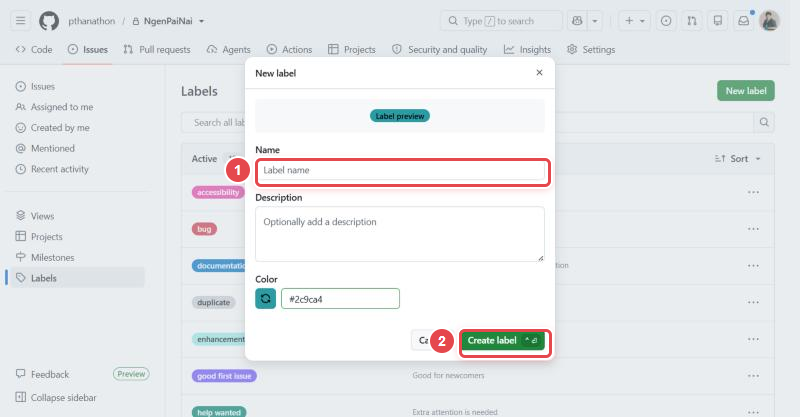

1. พิมพ์ชื่อ label เช่น `story`
2. กด **Create label** แล้วทำซ้ำอีกครั้งสำหรับ `task` และ `epic`

> issue template ของ repo นี้ติด label ให้อัตโนมัติ แต่จะติดได้ก็ต่อเมื่อ label นั้นมีอยู่แล้ว

## 2. สร้าง issue จาก template

เทียบได้กับปุ่ม Create ใน Jira

### ขั้นที่ 3: เลือก template ของ issue

[เปิดหน้านี้](https://github.com/pthanathon/NgenPaiNai/issues/new/choose)

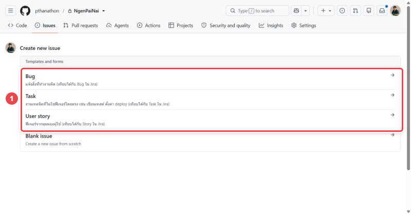

1. เลือกตามชนิดงาน: **Bug**, **Task** หรือ **User story** (เทียบได้กับ issue type ใน Jira)

### ขั้นที่ 4: กรอก User story

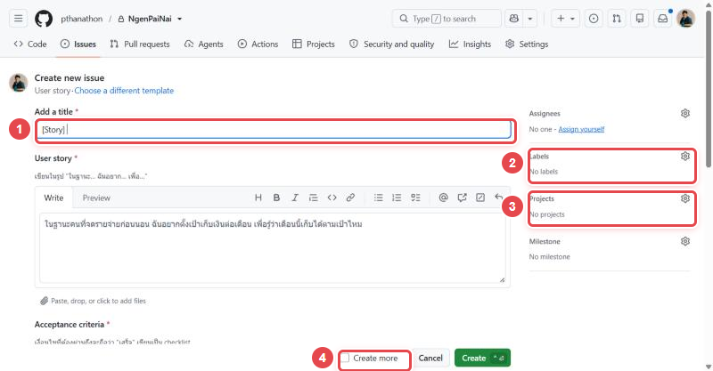

1. ตั้งชื่อต่อท้าย `[Story]` แล้วกรอก user story กับ acceptance criteria ด้านล่าง
2. **Labels** ยังขึ้นว่า "No labels" เพราะยังไม่ได้ทำขั้นที่ 2 ถ้าสร้าง label แล้วจะติด `story` ให้เอง
3. **Projects** เลือก "เงินไปไหน – Dev" ตรงนี้ได้เลย (หรือปล่อยให้ workflow ในขั้นที่ 16 เพิ่มให้)
4. ติ๊ก **Create more** แล้วจะสร้าง issue ถัดไปต่อได้ทันที เหมาะตอนลง backlog ทีละหลายใบ

## 3. ตั้งค่า Project

Project นี้สร้างจาก template "Team planning" ฟิลด์และ view ส่วนใหญ่จึงมีให้แล้ว

### ขั้นที่ 5: ส่วนต่างๆ ของ Project

[เปิดหน้านี้](https://github.com/users/pthanathon/projects/22)

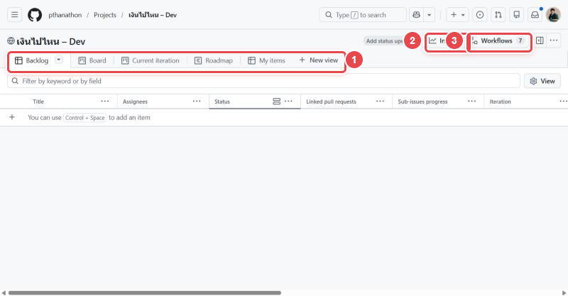

1. **View** ที่ template สร้างให้: Backlog (ตาราง), Board, Current iteration, Roadmap และ My items
2. **Insights**: หน้ากราฟ (ขั้นที่ 17)
3. **Workflows**: ระบบอัตโนมัติ เปิดอยู่ 7 ตัว (ขั้นที่ 15)

### ขั้นที่ 6: ดูฟิลด์ที่มีอยู่ (เมนู ⋯ → Settings)

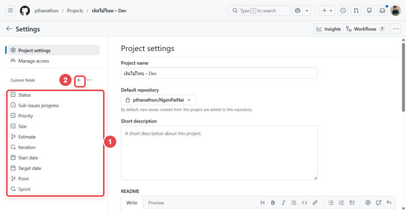

1. ฟิลด์ทั้งหมดของ Project template ให้มาแล้ว 7 ตัว: Status, Sub-issues progress, Priority, Size, Estimate, Iteration, Start/Target date
2. ปุ่ม **+** ตรงนี้ใช้สร้างฟิลด์ใหม่ได้เหมือนกัน

> ⚠️ ตอนนี้มี **Point** ซ้ำกับ **Estimate** และ **Sprint** ซ้ำกับ **Iteration** ควรเลือกใช้อย่างละตัว คู่มือนี้ใช้ **Estimate** เป็น story points และ **Iteration** เป็น sprint ถ้าไม่ใช้ Point กับ Sprint ลบได้ที่หน้านี้ (คลิกชื่อฟิลด์ → Delete field)

### ขั้นที่ 7: อีกทางในการเพิ่มฟิลด์: ปุ่ม + ท้ายตาราง

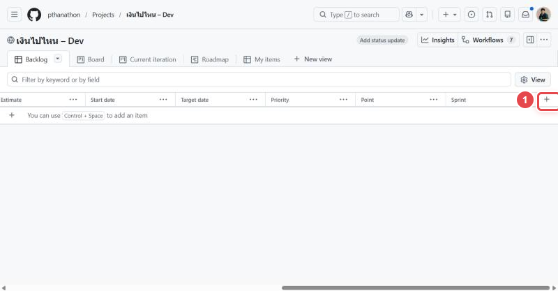

1. ใน view ตาราง เลื่อนไปขวาสุด (Shift + ล้อเมาส์) แล้วกด **+**

### ขั้นที่ 8: เลือก New field

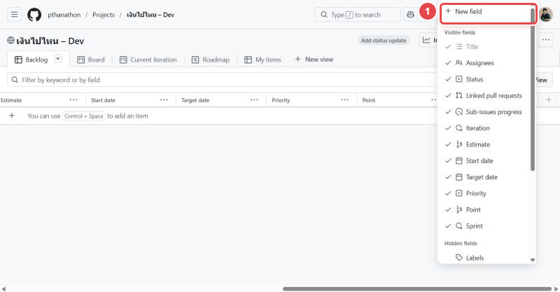

1. กด **New field** รายการด้านล่างใช้ซ่อนหรือแสดงคอลัมน์ในตาราง

### ขั้นที่ 9: ตั้งชื่อและชนิดฟิลด์

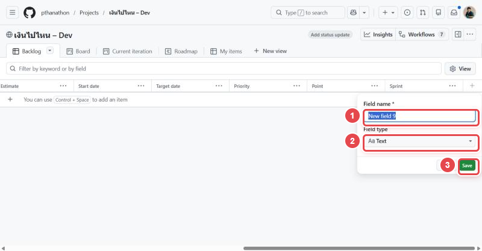

1. ชื่อฟิลด์
2. ชนิดฟิลด์ (ดูขั้นถัดไป)
3. กด **Save**

### ขั้นที่ 10: ชนิดฟิลด์ที่เลือกได้

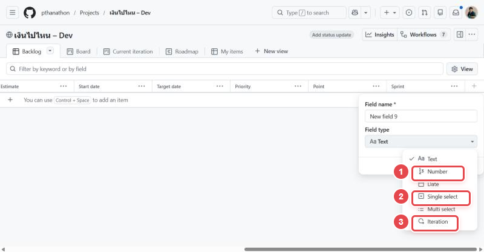

1. **Number**: ใช้กับ story points เพราะ Insights รวมผล (Sum) ได้
2. **Single select**: ตัวเลือกเดียว เช่น Priority หรือ Status
3. **Iteration**: ใช้เป็น sprint

### ขั้นที่ 11: ตั้งค่า sprint (ฟิลด์ Iteration)

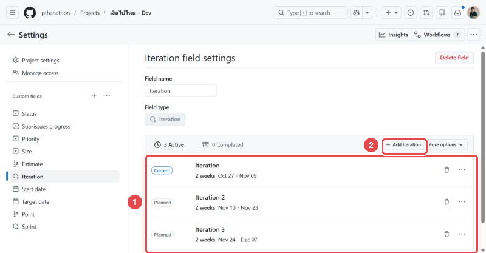

1. template สร้างไว้ 3 sprint ยาว **2 สัปดาห์** เริ่ม 27 ต.ค. sprint ที่กำลังทำอยู่มีป้าย **Current**
2. **Add iteration** เพิ่ม sprint ถัดไป ส่วนเมนู More options ใช้เปลี่ยนความยาวหรือเพิ่มช่วงพักได้

## 4. ทำ backlog และแบ่ง sprint

ใช้ filter กับ view จัดงาน

### ขั้นที่ 12: กรองงานด้วย filter

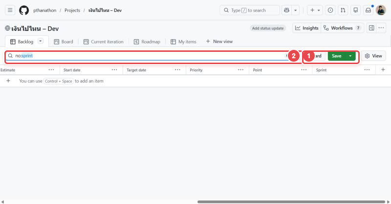

1. พิมพ์ filter ในช่องนี้ ภาพนี้พิมพ์ `no:sprint` ตามฟิลด์ Sprint ถ้าใช้ Iteration ให้พิมพ์ `no:iteration` จะได้ **product backlog** (งานที่ยังไม่อยู่ใน sprint ไหน)
2. **Save** เก็บ filter ไว้กับ view นี้ ส่วน **Discard** ยกเลิก

| filter | ได้อะไร |
|---|---|
| `no:iteration` | งานที่ยังไม่อยู่ใน sprint (backlog) |
| `iteration:@current` | งานใน sprint ปัจจุบัน |
| `iteration:@next` | งานที่วางไว้ sprint หน้า |
| `-status:Done` | ซ่อนงานที่เสร็จแล้ว |
| `label:bug` | เฉพาะ bug |

### ขั้นที่ 13: ตั้งค่า view (ปุ่ม View)

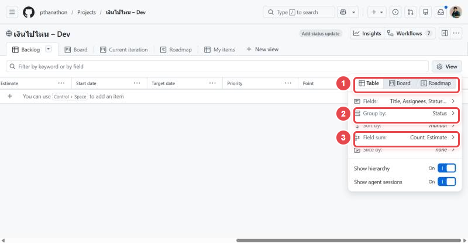

1. เปลี่ยนรูปแบบ: Table / Board / Roadmap
2. **Group by**: จัดกลุ่ม เช่น ตาม Iteration เพื่อดูงานแยกตาม sprint ระหว่างวางแผน
3. **Field sum**: แสดงผลรวม Estimate ใช้ดูว่าแต้มรวมเกินกำลังของ sprint หรือไม่

### ขั้นที่ 14: Sprint board

[เปิดหน้านี้](https://github.com/users/pthanathon/projects/22/views/2)

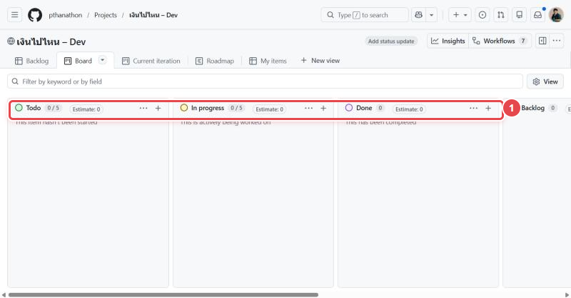

1. แต่ละคอลัมน์คือ Status พร้อมจำนวนการ์ดและแต้ม Estimate รวม ลากการ์ดข้ามคอลัมน์เพื่อเปลี่ยนสถานะ ถ้าใส่ filter `iteration:@current` จะเห็นเฉพาะงานใน sprint นี้

## 5. ตั้งระบบอัตโนมัติ

ให้การ์ดย้ายสถานะเองเมื่อปิด issue หรือ merge PR

### ขั้นที่ 15: Workflows ที่เปิดอยู่

[เปิดหน้านี้](https://github.com/users/pthanathon/projects/22/workflows)

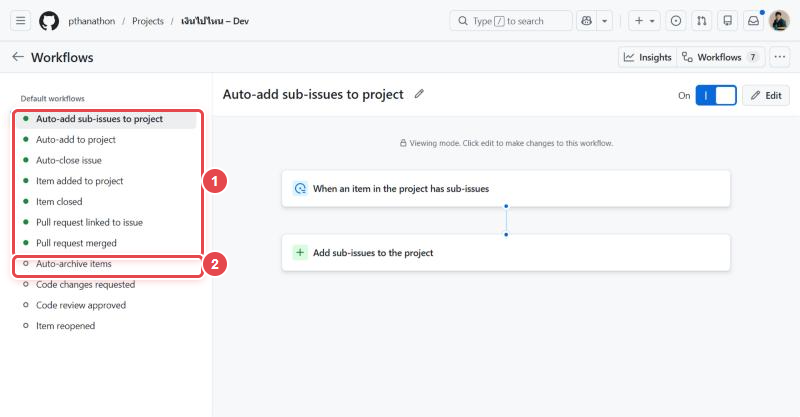

1. จุดเขียว = เปิดอยู่ เช่น **Item closed** ย้ายการ์ดไป Done เอง และ **Pull request merged** ก็เช่นกัน
2. **Auto-archive items** ปิดอยู่ ซึ่งถูกต้อง เพราะ Insights ไม่นับ item ที่ archive แล้ว กราฟจะหายถ้าเปิด

### ขั้นที่ 16: Auto-add: เพิ่ม issue ใหม่เข้า Project เอง

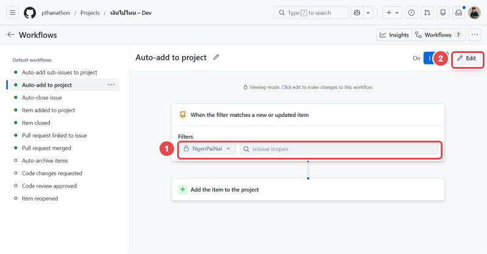

1. ตอนนี้ตั้งให้เพิ่ม issue ที่เปิดอยู่ของ repo NgenPaiNai ทุกใบ (`is:issue is:open`)
2. กด **Edit** ถ้าอยากเปลี่ยน filter เช่น เอาเฉพาะ `label:story,task,bug`

## 6. ดูรายงาน (burn up)

ใช้แทน burndown ของ Jira

### ขั้นที่ 17: กราฟ Burn up

[เปิดหน้านี้](https://github.com/users/pthanathon/projects/22/insights)

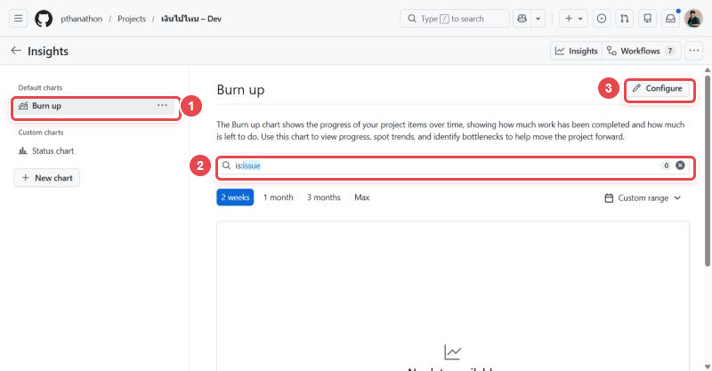

1. **Burn up** มีให้ในบัญชีนี้แล้ว (บัญชีส่วนตัว ตรวจเมื่อ 28 ต.ค. 2569) ตอนนี้ยังไม่มีข้อมูลเพราะยังไม่มี issue
2. เปลี่ยน filter เป็น `iteration:@current` เพื่อดูเฉพาะ sprint นี้ ส่วนที่เป็น **Open** คือ "งานคงเหลือ" ซึ่งให้ข้อมูลเดียวกับ burndown
3. กด **Configure** เพื่อเปลี่ยนสิ่งที่นับ (ขั้นถัดไป)

### ขั้นที่ 18: นับเป็นแต้มแทนจำนวน issue

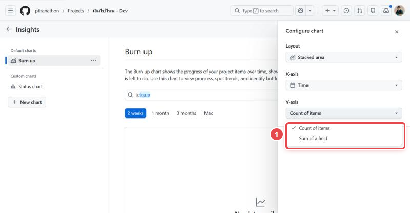

1. ที่ Y-axis เลือก **Sum of a field** แล้วเลือก **Estimate** กราฟจะเป็น burn up ตาม story points แล้วกด **Save to new chart**

> GitHub ไม่มี burndown แบบมีเส้นอุดมคติให้ในตัว ถ้าทีมต้องการจริงๆ ต้องใช้เครื่องมือเสริม หรือเขียน GitHub Action ดึงข้อมูลมาวาดเอง

## Story points: ใส่ 1 ค่าต่อ issue

ใส่ในฟิลด์ **Estimate** เป็นตัวเลขบอกขนาดงานเมื่อเทียบกับงานอื่น ไม่ใช่จำนวนชั่วโมง

| แต้ม | ความหมาย | ตัวอย่างจาก backlog |
|---|---|---|
| 1 | งานเล็กมาก รู้ชัดว่าต้องทำอะไร | B1 เปิด GitHub Pages |
| 2 | งานเล็ก | B2 เพิ่ม manifest กับไอคอน |
| 3 | งานกลาง ตรงไปตรงมา | A1 ตั้งเป้าเก็บเงินในเมนู |
| 5 | งานกลาง มีหลายส่วน | A2 แสดงความคืบหน้าเป้าในหน้าแรก |
| 8 | งานใหญ่ หรือยังมีจุดที่ไม่แน่ใจ | C3 เพิ่มหรือแก้หมวดเองได้ |
| 13 | ใหญ่เกินไป ควรแตกเป็นหลาย story ก่อน | – |

## Product backlog ตัวอย่างของเงินไปไหน

**Epic A: เป้าเก็บเงิน**

| # | ชนิด | ชื่อ | Estimate | Priority |
|---|---|---|---|---|
| A1 | Story | ตั้งเป้าเก็บเงินต่อเดือนในเมนู ⋯ | 3 | P1 |
| A2 | Story | แสดงความคืบหน้าเป้าเก็บเงินในหน้าแรก | 5 | P1 |
| A3 | Story | สรุปท้ายเดือนว่าเก็บได้ตามเป้าไหม | 2 | P2 |

**Epic B: ใช้บนมือถือเหมือนแอปจริง**

| # | ชนิด | ชื่อ | Estimate | Priority |
|---|---|---|---|---|
| B1 | Task | เปิด GitHub Pages ให้แอปมีลิงก์เข้าใช้จากมือถือ | 1 | P0 |
| B2 | Story | เพิ่ม web app manifest และไอคอน | 2 | P1 |
| B3 | Story | ใช้งานออฟไลน์ด้วย service worker | 5 | P2 |
| B4 | Bug | ตรวจว่าคีย์บอร์ดมือถือบังปุ่ม "บันทึก" หรือไม่ | 2 | P0 |

**Epic C: จดเร็วขึ้น**

| # | ชนิด | ชื่อ | Estimate | Priority |
|---|---|---|---|---|
| C1 | Story | ปุ่มรายการที่จดบ่อย แตะครั้งเดียวจดได้ | 5 | P1 |
| C2 | Story | ค้นหารายการจากบันทึกช่วยจำ | 3 | P2 |
| C3 | Story | เพิ่มหรือแก้ชื่อหมวดเองได้ | 8 | P2 |

**Epic D: คุณภาพโค้ด**

| # | ชนิด | ชื่อ | Estimate | Priority |
|---|---|---|---|---|
| D1 | Task | unit test ให้ parseAmount และการคำนวณงบ | 3 | P1 |
| D2 | Task | GitHub Actions รันเทสต์ทุกครั้งที่ push | 2 | P2 |

รวม 12 งาน 41 แต้ม ตัวอย่าง sprint แรก (2 สัปดาห์): B1 + B4 + A1 + B2 + D1 = 11 แต้ม

## สรุปสำหรับเล่าให้พี่เลี้ยงฟัง

**ข้อดี**
- อยู่ที่เดียวกับโค้ด ปิด issue ได้จาก PR (`Closes #12`) และการ์ดย้ายไป Done เอง
- ฟิลด์และ view ปรับได้ยืดหยุ่น Project เดียวดึงงานจากหลาย repo ได้
- บัญชีส่วนตัวแบบฟรีก็ใช้ Burn up ได้ และนับเป็นแต้มได้ (ตรวจแล้ว 28 ต.ค. 2569)

**ข้อที่ด้อยกว่า Jira**
- ไม่มี burndown แบบมีเส้นอุดมคติในตัว
- ไม่มีปุ่ม start/complete sprint งานค้างต้องย้ายเอง
- ไม่มีรายงาน velocity สำเร็จรูป ต้องสร้างกราฟเอง
- Issue types มีเฉพาะ organization
- ไม่มีเครื่องมือย้ายข้อมูลจาก Jira ในตัว
